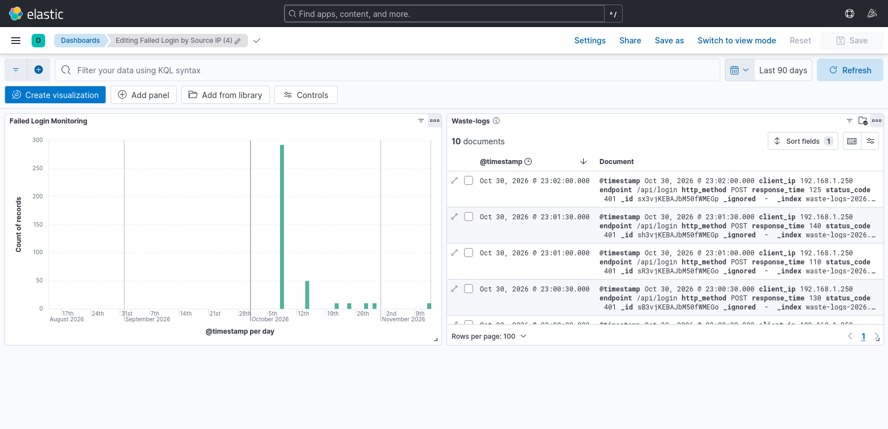

## 11. Sigma Detection Rules

Sigma was used to define standardized detection logic for security monitoring.

### 11.1 Spoofing Detection

The failed login detection identifies unsuccessful login attempts against the application.

Detection criteria:
- Endpoint: `/api/login`
- Status code: `401`
- Correlation field: `client_ip`
- Threshold: 5 or more events within 5 minutes
- Severity: High
- MITRE ATT&CK: T1110 – Brute Force

Sigma files:
- `detection-rules/spoofing-base.yml`
- `detection-rules/spoofing-correlation.yml`

### 11.2 Tampering Detection

The tampering detection rule identifies HTTP methods commonly associated with resource modification or deletion.

Detection criteria:
- HTTP methods: PUT, PATCH, DELETE
- Severity: Medium

False positives may include authorized administrative changes, normal application workflows, and QA testing activities.

Investigation includes reviewing the source IP, user identity, endpoint, and application audit logs. A matching request is an indicator for investigation and does not automatically prove unauthorized activity.

Rule file: `detection-rules/tampering-rule.json`

## 12. Sigma Validation and Testing

Sigma rules were validated using the Sigma CLI.

Validation command:

` sigma check detection-rules/ `

The validation completed with zero rule errors, condition errors, and validation issues.

The failed login correlation logic was converted into Elasticsearch ES|QL and tested in Kibana Dev Tools.

The test identified 10 failed login events from source IP `192.168.1.25`, meeting the configured threshold of five events within five minutes.

Note: The query logic was initially tested against sample logs. A Kibana Elasticsearch query alert was subsequently configured and successfully tested using five synthetic failed-login events.

## 13. Testing Evidence

The following screenshots provide evidence of the detection testing:

- `evidence/spoofing-sigma-kibana-test.png` – Failed login detection testing.
- `evidence/spoofing-correlation-esql-test.png` – Correlation query testing in Kibana.
### Failed Login Alert Testing

The Kibana Failed Login Alert rule was tested using five synthetic failed-login events from the same source IP (`192.168.1.250`).

- **Detection query:** `endpoint: "/api/login" AND status_code: 401`
- **Data view:** `waste-logs-*`
- **Time window:** 5 minutes
- **Alert threshold:** Document count greater than 4
- **Test events:** 5
- **Initial alert document count:** 5
- **Result:** Alert successfully generated
- **Final alert status:** Recovered

The alert was generated when the document count exceeded the configured threshold. It subsequently recovered when no matching events were found in the next evaluation window.

### Kibana Security Dashboard Evidence

The Kibana dashboard, **Failed Login by Source IP**, provides visibility into key security metrics:

- **Failed Login Attempts:** Counts HTTP 401 responses for `/api/login`.
- **Failed Login Activity Over Time:** Displays failed login trends using a timestamp chart.
- **Source IP Addresses:** Identifies the client IP addresses associated with requests.
- **HTTP Methods and Endpoints:** Shows the request methods and accessed endpoints.
- **HTTP Status Codes:** Helps identify failed and successful HTTP responses.
- **Response Time:** Displays request response-time information.

**Dashboard Screenshot:**

